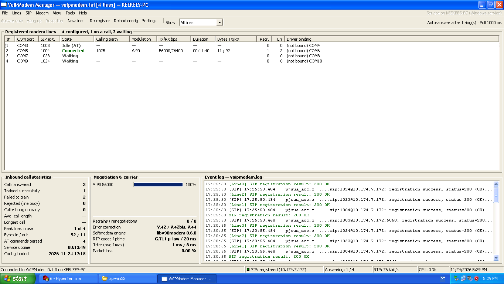
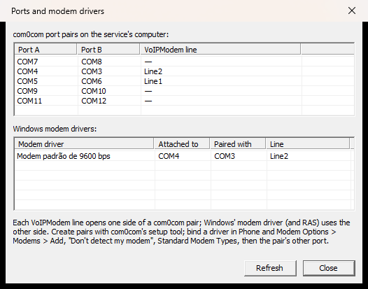
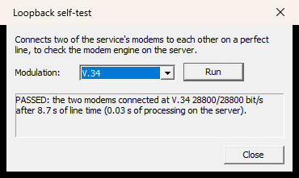

# VoIPModem

[](https://github.com/RedsonBr140/VoIPModem/actions/workflows/ci.yml)

A modem bank in software for Windows. Each line is a Hayes-compatible
modem on a (virtual) COM port on one side and a SIP extension on the
other. When a call comes in or goes out, the call's G.711 audio runs
through a real softmodem,
[libv90modem](https://github.com/georgica/libv90modem): V.8, then V.21
up to V.34 and V.90/V.92, with V.42 error control and V.42bis/V.44
compression. The resulting data stream is what the COM port carries, so
Windows' own modem driver and RAS can use the line like a hardware modem.

Two programs:

- **`VoIPModem.exe`**, the modem bank. It runs headless, in a console or
  as a Windows service, and serves a small control API (JSON over TCP,
  localhost by default).
- **`VoIPModemManager.exe`** (VoIPModem Manager), the operator's window:
  every line's state, caller, modulation and rates, call statistics,
  the event log; answer, hang up, reset, take lines out of service, add
  and edit lines and settings. It talks only to the API, so the service
  runs without it, and it can manage a service on another computer.



*VoIPModem Manager on Windows XP. The service runs as a Windows service
with four lines; line 2 is in a live V.90 call at 56000/26400.*

| | |
|---|---|
|  |  |
| Settings are written into `voipmodem.ini`, comments kept, and applied to idle lines. | New lines are offered a free com0com port; a line the service refuses keeps what you typed. |
|  |  |
| The service computer's com0com pairs and which Windows modem driver each line reaches. | A self-test that connects two of the service's modems to each other. |

Docs:

- `docs/PROJECT_SPEC.md`: requirements and goals.
- `docs/ARCHITECTURE.md`: how it works.
- `docs/CONTROL_API.md`: the control API, for the Manager or your own scripts.
- `docs/WINDOWS_RAS_DIALIN.md`: Windows RRAS answering dial-up calls on VoIPModem's lines.
- `docs/ROADMAP.md`: phase status and test results.
- `docs/LINUX.md`: the Linux port (in progress: runs on Linux; PPP over a call between two lines verified; not yet through Asterisk).
- `docs/design/`: the Manager's design mock-up.

## Status

Serial/Hayes command mode, SIP calls (both directions, multiple lines)
and RTP audio are complete and verified against Asterisk. Real modem data
links work: answering, VoIPModem connected at **V.90 56000/26400** with
V.42 LAPM and V.44 compression; calling, at **V.34 31200/14400** and V.21.
Those tests used a SIP software modem (BinModem) as the far end. A
physical analog modem (US Robotics Courier 56K) calling in through a
Cisco SPA112 FXS gateway connected at **V.34 31200/26400** and
V.32bis 14400; through the gateway, V.90/V.92 does not start up yet, so
such lines are limited to V.34. V.92 does not connect yet. RAS/PPP
(Phase 5) is started: Windows Server 2022 RRAS answered that call and
gave the Windows 11 caller a PPP session with internet access through
NAT, with two workarounds (edited Unimodem init strings, and
V.42bis/V.44 off). Legacy clients have not dialled in yet. The
service mode, control API and Manager have been run on Windows XP as a
Windows service, with a live V.90 call watched in the Manager (the
screenshot above). Details in `docs/ROADMAP.md`.

## Licence

VoIPModem links libv90modem, which is GPL-2.0-only, and PJSIP (GPL-2.0
or later). A distributed VoIPModem binary is therefore under GPL-2.0.
VoIPModem and the Manager also use JSON for Modern C++ (MIT,
`third_party/nlohmann`).

## Build

Requires Visual Studio with the C++ desktop workload (MSVC toolset
`v145`, or pass `/p:PlatformToolset=` with yours). Platforms: `x64` and
`Win32` (32-bit). These builds need Windows Vista or later; Windows XP and
Server 2003 need a separate build (see `docs/ROADMAP.md`, Phase 6).

**One-time setup** (PJSIP is built from source with its own solution;
build the platforms and configurations you need):

```powershell
git submodule update --init --recursive
.\scripts\setup-pjproject.ps1
msbuild third_party\pjproject\pjproject-vs14.sln /t:libpjproject /p:Configuration=Release-Static /p:Platform=x64 /p:PlatformToolset=v145
msbuild third_party\pjproject\pjproject-vs14.sln /t:libpjproject /p:Configuration=Release-Static /p:Platform=Win32 /p:PlatformToolset=v145
```

(`Debug-Static` for Debug builds.)

**Then build VoIPModem** (this also builds libv90modem, which is a
project in the same solution, and the Manager). Output goes to
`<Platform>\<Configuration>\` at the repository root, e.g.
`Win32\Release\VoIPModem.exe` and `Win32\Release\VoIPModemManager.exe`:

```
msbuild VoIPModem.sln /p:Configuration=Release /p:Platform=x64
msbuild VoIPModem.sln /p:Configuration=Release /p:Platform=Win32
```

Shared build settings (output folders, PJSIP paths and library names) live
in `build/VoIPModem.props`, which every project imports.

**Windows XP / Server 2003**: the `Debug-XP` and `Release-XP`
configurations (Win32 for XP, x64 for XP x64 and Server 2003 x64) use the
`v141_xp` toolset. Current Visual Studio no longer offers it; install
Visual Studio 2019 or 2022 Build Tools with "C++ Windows XP Support for
VS 2017 (v141) tools", alongside your main Visual Studio. Then:

```powershell
.\scripts\build-xp.ps1 -Platform Win32 -Configuration Release-XP
```

The script finds the installation that has `v141_xp`, builds the separate
PJSIP checkout `third_party/pjproject-xp`, then the solution, into
`Win32\Release-XP\`. (`-SkipPjproject` skips PJSIP on later runs.) The
result needs Windows XP SP3 (or Server 2003) and no runtime
redistributable: the C runtime is linked statically. Toolset choice per
configuration is in `build/VoIPModem.Toolset.props`.

## Run

1. Install com0com and create one port pair per line. VoIPModem opens
   one side; bind Windows' "(Standard Modem Types)" driver to the other
   side (Device Manager, Add legacy hardware, Modem). See
   `docs/ARCHITECTURE.md` "Windows integration".
2. Copy `config/voipmodem.ini.sample` to `voipmodem.ini` next to
   `VoIPModem.exe` (or pass its path as the first argument). Set each
   line's `ComPort`, and `[SIP] LocalPort` plus each line's `SipServer`,
   `SipExtension` and `SipPassword`. **Never commit real credentials**:
   `voipmodem.ini` is gitignored for that reason.
3. Run it, either way:
   - **In a console**: `VoIPModem.exe [path-to-ini]`. Stop with Ctrl+C.
   - **As a Windows service** (starts with Windows, no one logged on):
     from an administrator prompt, `VoIPModem.exe --install [path-to-ini]`
     (default: `voipmodem.ini` next to the exe), then
     `net start VoIPModem`. `VoIPModem.exe --uninstall` removes it. The
     Manager's File menu can install, start, stop and restart it too.
4. Use the line from the modem-driver side: RAS (step by step in
   `docs/WINDOWS_RAS_DIALIN.md`), or a terminal on the paired COM port.
   `ATDT<extension>` dials; `ATA` or `ATS0=<n>` answers.
   `CONNECT <rate>` means the modem link is up; after that the port
   carries data. `+++` (with a second of silence before and after)
   returns to command mode, and `ATH` hangs up.

**VoIPModem Manager**: start `VoIPModemManager.exe`. It connects to
127.0.0.1:7880 (File > Connect to service for another computer, port or
password) and refreshes once a second. Select a line to answer, hang up,
reset it or take it out of service; Modem > New modem line adds one;
Tools > Settings edits `voipmodem.ini` (comments are kept) and applies
the change to idle lines, or asks to restart the service for the SIP
transport, audio path and control API settings. Tools also has the
com0com pairs and modem drivers on the service's computer, a loopback
self-test of the modem engine, the SIP trace, and an AT console for the
modem side of a pair.

To see what a call is doing, set `[Logging] Level=Debug`: the log then
has the SIP trace, the modem's connect line (mode, rates, SNR, round
trip) and the V.42 state.

## Test

```
msbuild tests\VoIPModem.Tests.vcxproj /p:Configuration=Debug /p:Platform=x64
x64\Debug\VoIPModem.Tests.exe
```

A small hand-rolled framework (`tests/TestFramework.h`), no external
dependency. It covers the Hayes parser, the state machine (with a fake
call controller), config loading and the ini writer, the control API
server (over a real loopback socket, password included), the call
statistics, com0com pairing, and the MSVC build of libv90modem (two
modems connected back to back). Calls through real SIP, links with real
modems, and the Manager's window are tested by hand; `docs/ROADMAP.md`
records what has been.

## Continuous integration

`.github/workflows/ci.yml` builds Debug and Release for x64 and Win32 on
GitHub's `windows-2022` runner and runs the tests on every push and pull
request; the Release binaries are kept as artifacts. The runner has Visual Studio
2022, so CI overrides the projects' `v145` toolset with `v143`. pjproject's
build is cached by submodule commit, toolset, configuration and
`config_site.h`. Pushing a `v*` tag runs `release.yml`, which publishes a
GitHub release with a zip per platform (`win-x64`, `win-x86`), each with
both programs, the sample config and the licence texts of libv90modem,
PJSIP and JSON for Modern C++. Dependabot proposes weekly
updates to the actions and both submodules.
