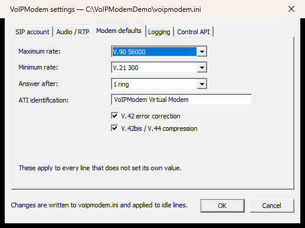
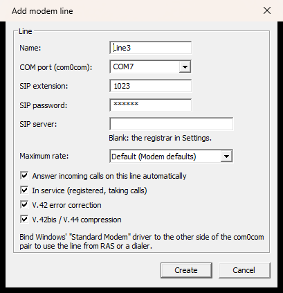

# VoIPModem

[](https://github.com/RedsonBr140/VoIPModem/actions/workflows/ci.yml)

VoIPModem is a bank of dial-up modems in software. It answers and places
modem calls over a SIP phone system such as Asterisk, so an old computer
with a real modem can dial in through a phone adapter and get a genuine
dial-up connection, with no phone line and no hardware modem on the
server.

Each line behaves like a hardware modem plugged into the computer. The
computer's own dial-up software takes it from there: Routing and Remote
Access (RRAS) on Windows, or pppd and mgetty on Linux, logs the caller in
and gives it network access. It works the other way too: anything that
can dial a modem, such as Windows' Dial-Up Networking or a terminal
program, can call out through a line.

```
old PC + modem -> phone adapter (ATA / FXS) -> Asterisk -> VoIPModem -> RRAS or pppd -> network
```

It runs on Windows and Linux.


*VoIPModem Manager on Windows XP, with four lines; line 2 is in a V.90
call at 56000/26400.*

| | |
|---|---|
|  |  |
| Settings | Adding a modem line |
|  |  |
| Which virtual port and Windows modem each line uses | A self-test that connects two of VoIPModem's modems to each other |

## What it can do

- Answer and place modem calls, on several lines at once. Each line is
  its own SIP extension.
- Dial out like any modem: software on the line's port dials with
  `ATDT`, whether that is Windows' Dial-Up Networking through the
  standard modem driver, pppd, or a terminal program.
- Make real modem connections, tested against other modems up to V.90
  (56000 bit/s), with V.42 error correction and V.42bis/V.44
  compression. The modem itself is
  [libv90modem](https://github.com/georgica/libv90modem).
- Look like an ordinary Hayes-compatible (AT command) modem on a serial
  port: a virtual COM port on Windows (made with com0com), a virtual
  terminal on Linux.
- On Windows, run as a service, with Windows' standard modem driver and
  RRAS using the lines like hardware modems.
- On Linux, serve pppd or mgetty, with PAP, CHAP or MS-CHAPv2 logins.
- **VoIPModem Manager** (Windows): watch every line's state, caller,
  speed and statistics; answer, hang up, add and edit lines and
  settings. It can manage VoIPModem on another computer, a Linux one
  included.

## Current state

Early: version 0.0.2. Tested for real so far:

- A US Robotics Courier 56K calling in through a Cisco SPA112 phone
  adapter connected at V.34 (31200 bit/s), and, since libv90modem
  0.6.1, at V.90 (49333/7200). Windows Server 2022 RRAS
  gave that Windows 11 caller internet access, with two workarounds (see
  `docs/WINDOWS_RAS_DIALIN.md`).
- BinModem, a SIP software modem, connected at V.90 (56000/26400) when
  calling VoIPModem, on Windows and on Linux. VoIPModem calling BinModem
  connected at V.34 (31200/14400).
- On Linux (Debian 13), pppd and mgetty ran dial-in sessions over
  VoIPModem's lines, with password logins.
- The service and the Manager run on Windows XP.

### Known limitations

- A real modem calling through a phone adapter only reaches V.34 (about
  31 kbit/s); V.90 does not start up that way yet.
- V.92 does not connect with other modems yet; answered calls settle at
  V.90. Calling out to a V.92 modem has failed; if it does, limit the
  line to V.34 (`Modulations=V21,V22,V32BIS,V34`).
- Compression (V.42bis/V.44) can stall or drop a dial-up session. If
  that happens, turn it off for the line (`Compression=0`).
- No legacy computer (Windows 98, XP...) has dialled in yet, which is the
  project's main goal.
- Windows Server 2003 has not been tried yet, and there is no 64-bit
  XP / Server 2003 build (32-bit XP works).
- On Linux: not yet tried with a real modem, with FreeRADIUS, or as a
  systemd service; only Debian 13 on x86_64 has been tested; no
  ready-made download.
- The connection between the Manager and the service is not encrypted.
  Keep it on the same computer, or on a trusted network with a password.

## Planned

- A legacy computer (Windows 98 with a real modem) dialling in: the
  original goal.
- Fixing the compression problem.
- V.90 through phone adapters, and V.92.
- Windows Server 2003, and a 64-bit XP / Server 2003 build.
- On Linux: FreeRADIUS logins, the systemd service, and ready-made
  downloads.

## What it will not do

- **Run PPP or log callers in itself.** That is the dial-up server's
  job (RRAS on Windows, pppd on Linux). VoIPModem only provides the
  modems.
- **Replace your phone system.** It needs a SIP server such as Asterisk.
- **Dial from the Manager.** The Manager can answer and hang up, but it
  has no dial button: calls out are dialled by the software using the
  line, as with a hardware modem.
- **A Linux version of the Manager.** The Manager is a Windows program;
  it can manage a Linux server over the network.

## Download

Ready-to-run Windows builds (64-bit and 32-bit, Windows Vista or later)
are on the [Releases](https://github.com/RedsonBr140/VoIPModem/releases)
page. For Windows XP, Server 2003 or Linux, build from source.

## Build

### Windows

Needs Visual Studio with "Desktop development with C++". From a
Developer PowerShell, in the repository:

```powershell
git submodule update --init --recursive
.\scripts\setup-pjproject.ps1
msbuild third_party\pjproject\pjproject-vs14.sln /t:libpjproject /p:Configuration=Release-Static /p:Platform=x64 /p:PlatformToolset=v145
msbuild VoIPModem.sln /p:Configuration=Release /p:Platform=x64
```

You get `x64\Release\VoIPModem.exe` and `VoIPModemManager.exe`. For
32-bit, use `Win32` instead of `x64`. If your Visual Studio's toolset is
not `v145`, pass `/p:PlatformToolset=` with yours to both `msbuild`
commands.

**Windows XP and Server 2003** need Visual Studio 2019 or 2022 Build
Tools with "C++ Windows XP Support for VS 2017 (v141) tools", then:

```powershell
.\scripts\build-xp.ps1 -Platform Win32 -Configuration Release-XP
```

The result, in `Win32\Release-XP\`, runs on Windows XP SP3 with nothing
else to install. (Server 2003 should run it too, but has not been tried.)

### Linux

Needs CMake 3.28 or later, a C/C++ compiler and make.

```sh
git submodule update --init third_party/pjproject third_party/libv90modem
cmake -S . -B build-linux -DCMAKE_BUILD_TYPE=Release
cmake --build build-linux -j"$(nproc)"
sudo cmake --install build-linux    # optional: /usr/local/bin/voipmodem
```

You get `build-linux/voipmodem`. The Manager is not built on Linux.

## Run

`voipmodem.ini` holds your SIP passwords: keep it private. Start from
`config/voipmodem.ini.sample`, which explains every setting.

### Windows

1. Install [com0com](https://com0com.sourceforge.net/) and create one
   pair of virtual COM ports per line, for example COM3 and COM4.
2. On the second port of each pair, install Windows' standard modem:
   Device Manager, Add legacy hardware, Modem, "(Standard Modem Types)".
3. Copy `config/voipmodem.ini.sample` to `voipmodem.ini` next to
   `VoIPModem.exe`. For each line, set `ComPort` (the first port of the
   pair, e.g. `COM3`) and the line's SIP server, extension and password.
4. Start it:
   - in a console: `VoIPModem.exe` (Ctrl+C stops it);
   - or as a Windows service, from an administrator prompt:
     `VoIPModem.exe --install`, then `net start VoIPModem`.
     `VoIPModem.exe --uninstall` removes it. The Manager's File menu can
     do this too.
5. Set up RRAS to answer on the modems: `docs/WINDOWS_RAS_DIALIN.md`
   goes step by step.

Open `VoIPModemManager.exe` to watch and manage the lines.

### Linux

1. Create a folder for the modem ports: `sudo mkdir /run/voipmodem`
   (owned by the user VoIPModem runs as).
2. Write a `voipmodem.ini` from the sample. Each line's `ComPort` is
   where VoIPModem creates that line's port, for example
   `ComPort=/run/voipmodem/ttyVM0`. Set the SIP settings as on Windows.
3. Start it: `voipmodem /path/to/voipmodem.ini` (Ctrl+C stops it).
   `config/voipmodem.service` is a systemd unit for it (not tried yet).
4. Run pppd or mgetty on each port. `docs/LINUX.md` has setups that
   work.

To manage a Linux server from the Manager, set `BindAddress` and
`Password` in the ini's `[Control]` section, then use File > Connect to
service on the Windows computer.

If a call misbehaves, set `Level=Debug` under `[Logging]` and look at
the log.

## Documentation

- `docs/WINDOWS_RAS_DIALIN.md`: a Windows dial-in server, step by step.
- `docs/LINUX.md`: Linux setup with pppd and mgetty, and test results.
- `docs/CONTROL_API.md`: controlling VoIPModem from your own scripts.
- `docs/ROADMAP.md`: detailed status and test results.
- `docs/ARCHITECTURE.md`: how it works inside.
- `docs/PROJECT_SPEC.md`: the original requirements.
- `CONTRIBUTING.md`: for working on VoIPModem itself: tests, CI and
  releases.

## Licence

VoIPModem uses libv90modem (GPL-2.0-only) and PJSIP (GPL-2.0 or
later), so VoIPModem binaries are under the GPL-2.0. It also uses JSON
for Modern C++ (MIT).
